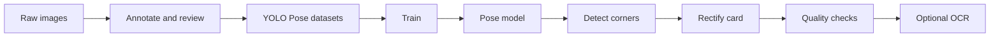
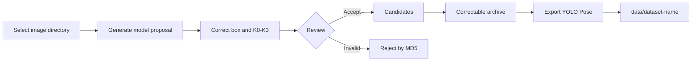

# ID Card Pose Detector

A YOLO Pose pipeline for ID card detection and rectification. It predicts the card boundary and four semantic corners, then performs perspective rectification, image quality checks, and optional OCR.

## Features

| Component | Capability |
| --- | --- |
| Annotation | Review, correct, archive, and export labels with [ID Card Label Tool](https://github.com/DigInsight-AI/tool-idcard-label) |
| Training | Merge multiple datasets, train from scratch, resume runs, and prune checkpoints |
| Detection | Predict card boxes, confidence scores, and four semantic corners |
| Processing | Rectify cards and detect blur, exposure, glare, clipping, and resolution issues |
| OCR | Pass rectified cards to an external command and save its JSON response |



## Quick Start

```bash
python3 -m venv .venv
.venv/bin/python -m pip install -r requirements-ml.txt
```

| Task | Command |
| --- | --- |
| Train | `./scripts/pose-train.sh` |
| Infer | `POSE_MODEL=/path/to/best.pt ./scripts/pose-infer.sh /path/to/image.jpg /tmp/idcard-result` |
| Test | `.venv/bin/python -m unittest discover -s idcard_detector/tests -v` |

## Data Annotation

Use [DigInsight-AI/tool-idcard-label](https://github.com/DigInsight-AI/tool-idcard-label) to turn raw images into reviewed YOLO Pose datasets. The tool provides local model-assisted annotation, manual correction, quality gates, editable archives, and dataset export.

### 1. Start the Labeling Tool

```bash
git clone https://github.com/DigInsight-AI/tool-idcard-label.git
cd tool-idcard-label
./scripts/idcard-label-start.sh
```

Open `http://127.0.0.1:8765`, then select an input image directory and an empty workspace directory. Input images remain read-only; review state and labels are stored in the workspace.

### 2. Annotate and Review



Each card must contain one bounding box and exactly four semantic keypoints. Keypoint order follows the physical card in its upright orientation, regardless of image rotation.

| Keypoint | Meaning |
| --- | --- |
| `K0` | Top-left |
| `K1` | Top-right |
| `K2` | Bottom-right |
| `K3` | Bottom-left |

Recommended flow: correct targets and `K0-K3` → verify class and visibility → add to candidates → archive reviewed candidates → export YOLO Pose.

### 3. Export to This Project

In the labeling tool, open **Archives**, select one archive, and export it as a YOLO Pose dataset. Place each export under this project's `data/` directory:

```text
data/
├── batch-001/
│   ├── data.yaml
│   ├── images/train/
│   ├── images/val/
│   ├── labels/train/
│   └── labels/val/
└── batch-002/
    └── data.yaml
```

Training automatically discovers `data/*/data.yaml`, validates class and keypoint contracts, and builds a combined snapshot. Samples are deduplicated by filename stem; the most recently exported dataset wins. Source images and labels are never modified.

> ID card images contain sensitive personal data. Collect and process them only with proper authorization, and never commit datasets, workspaces, model outputs, or personal information to Git.

## Construct Additional Training Data

Generate a separate YOLO Pose training shard from an existing export or merged
snapshot. Each count is the exact number of **new** images, independent of the
number of source images:

```bash
./scripts/pose-augment.sh \
  --dataset runs/datasets/config_v3/data.yaml \
  --output datasets/augmented-v3 \
  --large 2000 --clipped 1000 --occluded 1000 \
  --occupancy-min 0.995 --occupancy-max 0.999 \
  --seed 42
```

| Option | Behavior |
| --- | --- |
| `--large N` | Generate N complete cards, tightly cropped on both axes |
| `--clipped N` | Generate N crops from different sides or across one corner |
| `--occluded N` | Generate N textured occlusions, focused on corners and edges |
| `--occlusion-profile` | `boundary` (default) or `mixed` (also covers the interior) |
| `--occupancy-min/max` | Target bbox side occupancy; defaults to 0.99–0.999 |
| `--image-size` | Longest output side, default 768; preserves proportions |
| `--preview-count` | Maximum annotated previews, default 24; 0 disables them |

Tight crops use a rectangular canvas matched to the card bbox, removing the
short-axis background left by square crops. This retains the original perspective;
side occupancy and actual quadrilateral area are reported separately. Integer
canvas dimensions can reduce one side's occupancy by less than one pixel. At the
maximum setting, visible corners can be less than one pixel from the image edge.

The output contains `images/train/`, `labels/train/`, `data.yaml`, a
`dataset_report.json`, and `lineage.jsonl` with source paths, seeds, transforms,
corners, visibility and bbox. `preview.jpg` and `previews/` show a bounded set of
annotated examples. Source images and labels remain unchanged; existing output
directories are rejected.

Only single-target training images with four visible, valid corners are eligible.
Validation images are excluded. Samples may reuse a source with different
augmentation parameters when the requested count exceeds the eligible sources.
Occluded corners retain their exact coordinates with visibility 1; corners outside
the crop use visibility 0 and zero exported coordinates. The bbox is recomputed
from the card polygon intersected with the output canvas. Occluders are synthetic
textured shapes, not real hand cutouts.

The default `boundary` profile repeats a ten-sample schedule: 40% single-corner,
20% adjacent-corner pair, 10% opposite-corner pair, 20% edge, and 10% corner plus
edge. Small counts use the prefix of this schedule, starting with K0 through K3.
Position, size, texture and covered side vary; intended covered-corner counts are
checked against the rendered mask. Covered area is limited to 1%–35% of the
visible card. Pure interior occlusion is excluded from this profile; select
`--occlusion-profile mixed` to include it. The report records actual variant
counts and coverage of each semantic corner.

The generated shard has `val: []`; combine it with original datasets for training
and validation. The default `data/*/data.yaml` discovery does not include the
example output under `datasets/`. To include a reviewed shard in training, generate
it at a new path such as `--output data/augmented-v3`, alongside the original
exports. The merger already supports this training-only shard and retains the
original validation split. Keep all generated samples out of validation.

## Training

The default configuration is [`config/config_v1.yaml`](config/config_v1.yaml):

```bash
./scripts/pose-train.sh
```

| Setting | Default | Description |
| --- | --- | --- |
| `data.root` | `data` | Root containing exported datasets |
| `model.architecture` | `yolo11n-pose.yaml` | Pose architecture trained from random weights |
| `model.initial_weights` | unset | Optional local `.pt` weights for a fresh fine-tuning run; requires `pretrained: true` |
| `output.project/name` | `runs/idcard-pose-v1` | Training output directory |
| `output.existing_run` | `prompt` | Resume or replace an existing run |
| `training.resume_from` | `null` | Optional `.pt` checkpoint for explicit resume |
| `training.device` | `mps` | Change to `cpu`, `0`, or another supported device |
| `training.keypoint_loss_sigmas` | `[0.25, 0.25, 0.25, 0.25]` | Keep coordinate gradients useful for initially distant corners |
| `data.keypoint_oks_sigmas` | `[0.025, 0.025, 0.025, 0.025]` | Strict evaluation tolerance, independent of training loss |

Use a different configuration:

```bash
POSE_CONFIG=/path/to/config_v2.yaml ./scripts/pose-train.sh
```

Results are written to `runs/idcard-pose-v1/`. `best.pt` and `last.pt` are always retained; `best_pose.pt` separately tracks the highest Pose mAP50-95, with its epoch and score in `best_pose.json`. `training.keep_last_n` controls periodic checkpoint retention. Default early stopping still follows the combined Box/Pose fitness.

### Fine-Tune After Adding Data

The v2 recipe starts from `runs/idcard-pose-v1/weights/best.pt` with a fresh optimizer and a 50-epoch schedule. It combines a lower learning rate (`0.0001`), zero bias warmup learning rate, and disabled mosaic and multi-scale augmentation to test refinement of reviewed corners. Both pose sigmas remain unchanged for comparable evaluation.

```bash
POSE_CONFIG=config/config_v2.yaml ./scripts/pose-train.sh
```

It copies current exports into `runs/datasets/config_v2` and writes results to `runs/idcard-pose-v2`. Existing v2 output causes an error rather than replacement. To resume an interrupted v2 run, change only `output.existing_run` to `resume` and repeat the command. This restores that run's optimizer and schedule; initial fine-tuning instead uses `model.initial_weights` with `training.resume_from: null`. Explicit `training.resume_from` and `model.initial_weights` are mutually exclusive.

The r008 refinement recipe in `config/config_v3.yaml` uses the local checkpoint `runs/pretrained/r008-best.pt`, adapts its single-class head to the current two classes, and writes to `runs/idcard-pose-v3-r008`. It retains r008's strict training sigma (`0.025`), learning rate (`0.0002`), final learning-rate factor (`0.05`), 3-epoch warmup (including bias warmup `0.1`), augmentation settings, and 150-epoch limit with patience 25. Place the historical r008 checkpoint at the configured path before starting:

```bash
POSE_CONFIG=config/config_v3.yaml ./scripts/pose-train.sh
```

Each completed epoch also writes a timestamped professional summary with train/validation losses, Box and Pose precision, recall, F1, mAP50, mAP75, mAP50-95, fitness, learning rates, duration, and per-class validation metrics.

| Training log | Contents |
| --- | --- |
| `train.log` | Human-readable per-epoch summaries, also printed to the console |
| `metrics.jsonl` | One structured metrics record per completed epoch |
| `class_metrics.csv` | Per-class Box and Pose metrics for every completed epoch |

## Inference

```bash
POSE_MODEL=/path/to/best.pt \
./scripts/pose-infer.sh /path/to/image.jpg /tmp/idcard-result
```

| Output | Contents |
| --- | --- |
| `result.json` | Boxes, keypoints, geometry, quality results, and optional OCR data |
| `card-000.png` | One rectified image for each valid card candidate |

To call an external OCR command that returns one JSON object:

```bash
POSE_MODEL=/path/to/best.pt \
./scripts/pose-infer.sh /path/to/image.jpg /tmp/idcard-result \
  --ocr-command 'your-ocr-command --image {image}'
```

## Project Structure

| Path | Purpose |
| --- | --- |
| `idcard_detector/` | Training, detection, rectification, and quality checks |
| `config/` | Training configuration |
| `scripts/` | Training and inference entry points |
| `data/` | Exported annotation datasets; do not commit sensitive data |
| `runs/` | Combined snapshots, training logs, and model weights |

## Contact

| Channel | Address |
| --- | --- |
| QQ | `3873199257` |
| Email | [reid.li@foxmail.com](mailto:reid.li@foxmail.com) |

## License

This project is licensed under the [MIT License](LICENSE).
