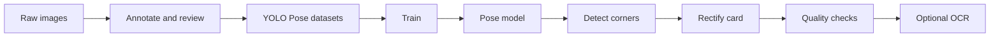
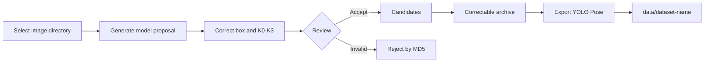

# ID Card Pose Detector

A YOLO Pose pipeline for ID card detection and rectification. It predicts the card boundary and four semantic corners, then performs perspective rectification, image quality checks, and optional OCR.

## Features

| Component | Capability |
| --- | --- |
| Annotation | Review, correct, archive, and export labels with [ID Card Label Tool](https://github.com/DigInsight-AI/tool-idcard-label) |
| Training | Merge multiple datasets, train from scratch, resume runs, and prune checkpoints |
| Detection | Predict card boxes, confidence scores, and four semantic corners |
| Processing | Rectify cards and detect blur, exposure, glare, clipping, and resolution issues |
| OCR | Pass rectified cards to an external command and save its JSON response |



## Quick Start

```bash
python3 -m venv .venv
.venv/bin/python -m pip install -r requirements-ml.txt
```

| Task | Command |
| --- | --- |
| Train | `./scripts/pose-train.sh` |
| Infer | `POSE_MODEL=/path/to/best.pt ./scripts/pose-infer.sh /path/to/image.jpg /tmp/idcard-result` |
| Test | `.venv/bin/python -m unittest discover -s idcard_detector/tests -v` |

## Data Annotation

Use [DigInsight-AI/tool-idcard-label](https://github.com/DigInsight-AI/tool-idcard-label) to turn raw images into reviewed YOLO Pose datasets. The tool provides local model-assisted annotation, manual correction, quality gates, editable archives, and dataset export.

### 1. Start the Labeling Tool

```bash
git clone https://github.com/DigInsight-AI/tool-idcard-label.git
cd tool-idcard-label
./scripts/idcard-label-start.sh
```

Open `http://127.0.0.1:8765`, then select an input image directory and an empty workspace directory. Input images remain read-only; review state and labels are stored in the workspace.

### 2. Annotate and Review



Each card must contain one bounding box and exactly four semantic keypoints. Keypoint order follows the physical card in its upright orientation, regardless of image rotation.

| Keypoint | Meaning |
| --- | --- |
| `K0` | Top-left |
| `K1` | Top-right |
| `K2` | Bottom-right |
| `K3` | Bottom-left |

Recommended flow: correct targets and `K0-K3` → verify class and visibility → add to candidates → archive reviewed candidates → export YOLO Pose.

### 3. Export to This Project

In the labeling tool, open **Archives**, select one archive, and export it as a YOLO Pose dataset. Place each export under this project's `data/` directory:

```text
data/
├── batch-001/
│   ├── data.yaml
│   ├── images/train/
│   ├── images/val/
│   ├── labels/train/
│   └── labels/val/
└── batch-002/
    └── data.yaml
```

Training automatically discovers `data/*/data.yaml`, validates class and keypoint contracts, and builds a combined snapshot. Samples are deduplicated by filename stem; the most recently exported dataset wins. Source images and labels are never modified.

> ID card images contain sensitive personal data. Collect and process them only with proper authorization, and never commit datasets, workspaces, model outputs, or personal information to Git.

## Training

The default configuration is [`config/config_v1.yaml`](config/config_v1.yaml):

```bash
./scripts/pose-train.sh
```

| Setting | Default | Description |
| --- | --- | --- |
| `data.root` | `data` | Root containing exported datasets |
| `model.architecture` | `yolo11n-pose.yaml` | Pose architecture trained from random weights |
| `output.project/name` | `runs/idcard-pose-v1` | Training output directory |
| `output.existing_run` | `prompt` | Resume or replace an existing run |
| `training.resume_from` | `null` | Optional `.pt` checkpoint for explicit resume |
| `training.device` | `mps` | Change to `cpu`, `0`, or another supported device |

Use a different configuration:

```bash
POSE_CONFIG=/path/to/config_v2.yaml ./scripts/pose-train.sh
```

Results are written to `runs/idcard-pose-v1/`. `best.pt` and `last.pt` are always retained; `training.keep_last_n` controls periodic checkpoint retention.

## Inference

```bash
POSE_MODEL=/path/to/best.pt \
./scripts/pose-infer.sh /path/to/image.jpg /tmp/idcard-result
```

| Output | Contents |
| --- | --- |
| `result.json` | Boxes, keypoints, geometry, quality results, and optional OCR data |
| `card-000.png` | One rectified image for each valid card candidate |

To call an external OCR command that returns one JSON object:

```bash
POSE_MODEL=/path/to/best.pt \
./scripts/pose-infer.sh /path/to/image.jpg /tmp/idcard-result \
  --ocr-command 'your-ocr-command --image {image}'
```

## Project Structure

| Path | Purpose |
| --- | --- |
| `idcard_detector/` | Training, detection, rectification, and quality checks |
| `config/` | Training configuration |
| `scripts/` | Training and inference entry points |
| `data/` | Exported annotation datasets; do not commit sensitive data |
| `runs/` | Combined snapshots, training logs, and model weights |

## Contact

| Channel | Address |
| --- | --- |
| QQ | `3873199257` |
| Email | [reid.li@foxmail.com](mailto:reid.li@foxmail.com) |

## License

This project is licensed under the [MIT License](LICENSE).
